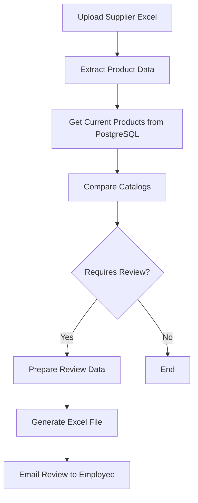

# Product Catalog Automation with n8n and PostgreSQL

🚧 **Work in Progress**

This project automates the comparison and review of supplier
catalog updates using n8n and PostgreSQL.

It detects price changes, stock changes, and missing product
information, generates an Excel review file, and automatically
sends it to the responsible employee by email.

## Features

- Excel-based supplier catalog processing
- Automated comparison with PostgreSQL catalog data
- Detection of price and stock changes
- Detection of missing prices and stock quantities
- Automatic generation of Excel review files
- Automated email notifications
- Human-in-the-loop review process

## Workflow

## Technologies

- n8n
- PostgreSQL
- SQL
- JavaScript
- Microsoft Excel
- Gmail

## Setup

1. Import the workflow JSON files into n8n.
2. Configure your PostgreSQL credentials.
3. Use the same database for all workflows.
4. Configure Gmail credentials and the review recipient.
5. Initialize the products table and populate it with the
   initial catalog data.

## How to Run

1. Run `initialize-catalog-public.json` to create the
   products table if required.
2. Open `supplier-catalog-update-public.json`.
3. Upload the supplier's Excel file containing the following columns:
   - `id`
   - `title`
   - `price`
   - `stock`
4. The workflow compares the supplier data with the current
   catalog stored in PostgreSQL.
5. Products requiring review are included in
   `catalog_review.xlsx`.
6. The generated Excel file is automatically sent to
   the responsible employee by email.
7. The employee reviews the proposed changes.

## Project Status

### Implemented and Tested

- Excel file processing
- Catalog comparison
- Price and stock change detection
- Missing information detection
- Excel review file generation
- Automated review emails

### In Development

- Automated supplier follow-up for missing information
- Supplier response and correction workflows
- Employee approval and rejection workflows
- Catalog updates based on approved decisions
- Audit logging with old and new values, timestamps,
  and employee information
- End-to-end testing

## Project Objective

The objective is to reduce manual catalog maintenance,
improve product data quality, and automate communication
between suppliers and employees while maintaining human
control over catalog updates.
